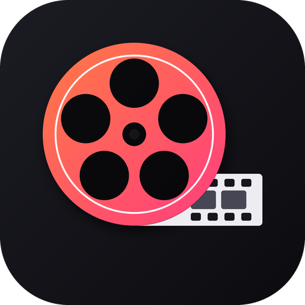
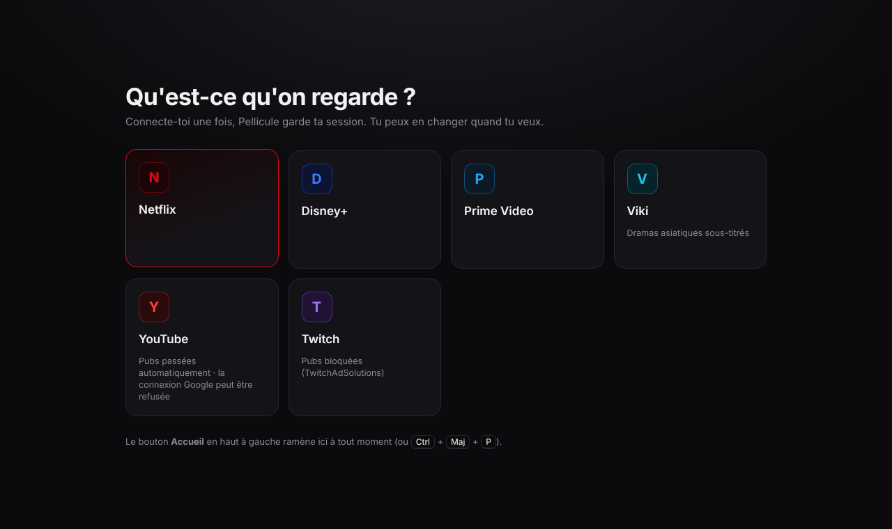

<p align="center">
  
</p>

<h1 align="center">Pellicule</h1>

<p align="center">
  Tes plateformes vidéo dans une seule appli Windows, stable, avec YouTube et Twitch sans pubs.<br>
  Netflix · Disney+ · Prime Video · Viki · YouTube · Twitch
</p>

<p align="center">
  <a href="https://github.com/BlancheLaGoat/pellicule/releases/latest"><b>⬇ Télécharger la dernière version</b></a>
</p>

<p align="center">
  
</p>

## Pourquoi Pellicule ?

Pellicule fait tourner le **site officiel** de chaque plateforme dans une appli dédiée, avec le module DRM Widevine : les films et séries protégés se lisent normalement, avec ton compte, ta liste et ta reprise de lecture. Une session par plateforme, donc tu restes connecté partout, et une seule fenêtre au lieu de six onglets de navigateur.

## Fonctionnalités

- **Toutes tes plateformes** : choisis-en une au premier lancement, change quand tu veux avec le bouton **Accueil** (la page en cours reste ouverte derrière ; « Revenir à … » ou `Échap` pour y retourner).
- **Mode flottant** (bouton ▣ dans la barre, ou `Ctrl + Maj + F`) : la fenêtre devient une petite vidéo **toujours au premier plan** dans un coin de l'écran, pour regarder en jouant ou en travaillant. Déplace-la et redimensionne-la : elle se rouvre au même endroit. Marche aussi avec Netflix et Disney+, qui bloquent l'« image dans l'image » du navigateur.
- **Plein écran** : celui du lecteur vidéo (la barre disparaît), ou `F11` / bouton ⛶ pour mettre toute l'appli en plein écran. `Échap` pour sortir.
- **YouTube sans pubs** : quand une pub démarre, Pellicule coupe le son, la passe en accéléré et clique sur « Passer » dès qu'il apparaît ; les bannières et encarts pub sont masqués.
- **Twitch sans pubs** : script *vaft* de [TwitchAdSolutions](https://github.com/pixeltris/TwitchAdSolutions) (MIT), qui cherche un flux sans pub. Projet archivé par son auteur en mars 2026 : s'il ne suffit plus, menu de l'icône → *Pubs Twitch* → *Couper le son et masquer*.
- **Mode onglets** (optionnel, menu de l'icône → *Mode onglets*) : plusieurs plateformes ouvertes en même temps, plusieurs onglets YouTube ou Twitch, et chaque onglet peut être **détaché dans sa propre fenêtre** (glisse-le vers le bas) sans recharger la page.
- **Pause en changeant d'onglet** : la vidéo que tu quittes (autre onglet ou Accueil) se met en pause, pour ne pas avoir le son en fond. Désactivable dans le menu de l'icône.
- **Retour / Suivant / Actualiser** dans la barre (aussi `Alt + ←/→`, boutons latéraux de la souris, `F5`).
- **Lecture / pause** depuis la barre et depuis l'aperçu de la barre des tâches Windows ; touches multimédia du clavier.
- **Fermer la fenêtre met la vidéo en pause** et range Pellicule près de l'horloge (tes connexions restent ouvertes). *Quitter* depuis le menu de l'icône pour la fermer vraiment.
- **Ne plante plus** : si une page crashe ou fige, Pellicule la relance là où tu étais.
- **Discord** (désactivé par défaut) : « Regarde … » sur ton profil.
- **Mises à jour automatiques** et **lancement au démarrage de Windows** (optionnel).

Tout se règle par **clic droit sur l'icône Pellicule** près de l'horloge.

## Qualité d'image

Pellicule lit les vidéos comme Google Chrome : **HD, pas de 4K ni de HDR** sur Netflix, Disney+ et Prime Video. Ces plateformes réservent la 4K à leurs applis officielles et à Edge, qui utilisent une protection matérielle (PlayReady) qu'aucune appli tierce ne peut utiliser. YouTube, Twitch et Viki n'ont pas cette limite.

## Installation

1. Télécharge `Pellicule-Setup-x.y.z.exe` depuis les [Releases](https://github.com/BlancheLaGoat/pellicule/releases/latest).
2. Lance-le. Si Windows affiche **« Windows a protégé votre ordinateur »**, clique sur **Informations complémentaires** puis **Exécuter quand même** (message normal pour une appli sans certificat Microsoft payant).
3. Choisis ta plateforme et connecte-toi.

## Questions fréquentes

**Netflix / Disney+ affiche une erreur de lecture.** Recharge (`F5`). En `npm start`, il faut avoir signé Electron (voir plus bas) ; l'installeur, lui, est signé automatiquement.

**La connexion Google est refusée.** Google bloque sa connexion dans les applis qui embarquent un navigateur. Connecte-toi par e-mail + mot de passe.

**Pourquoi plusieurs « Pellicule » dans le Gestionnaire des tâches ?** Pellicule est construit sur Chrome, qui sépare l'interface, le son, le réseau, le DRM et chaque page dans des processus différents. C'est ce qui permet de relancer une page plantée sans tout fermer.

---

## Pour les développeurs

```
npm install
python -m castlabs_evs.vmp sign-pkg node_modules/electron/dist
npm start
```

- `npm run dist` construit l'installeur dans `dist/`, signé automatiquement par Castlabs (compte EVS gratuit : `pip install castlabs-evs` puis `python -m castlabs_evs.account signup`).
- **Ajouter une plateforme** : une entrée dans `src/platforms.js` (nom, couleurs, adresse, domaines).
- **Discord** : mets l'*Application ID* de ton appli Discord dans `src/config.js`.
- **Publier une version** : change `"version"` dans `package.json`, commit, push, puis tag `vX.Y.Z`. Le workflow GitHub Actions (secrets `EVS_ACCOUNT` / `EVS_PASSWD`) construit, signe et publie la Release ; les Pellicule installés se mettent à jour tout seuls.

Le blocage des pubs Twitch reprend le script *vaft* de [TwitchAdSolutions](https://github.com/pixeltris/TwitchAdSolutions) (MIT, © TwitchAdSolutions Contributors), copié tel quel dans `src/vendor/`.

Construit avec [Electron for Content Security (Castlabs)](https://github.com/castlabs/electron-releases) et [electron-builder](https://www.electron.build/). Pellicule n'est affiliée à aucune des plateformes citées.
